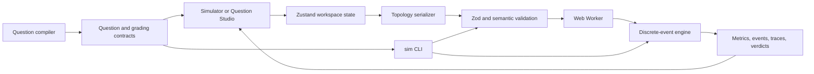

# NS System Design Simulator

> Design a distributed system, run deterministic traffic through it, and inspect where it fails.

NS System Design Simulator is a browser-based system-design builder, discrete-event simulator, learning environment, and question-authoring tool. The React application and headless CLI share the same TypeScript engine, validation rules, grading contracts, and `TopologyJSON` format.

The repository currently ships two web surfaces:

- **Simulator** (`/`) — build, run, debug, compare, and grade system designs.
- **Question Studio** (`/question-studio`) — author, preview, verify, and export simulator-backed learning activities.

It is a client-side Vite application. Simulation runs in a Web Worker; the optional development-only LLM grading proxy runs in the local Vite server.

## What is included

### Visual system-design workspace

- Drag-and-drop React Flow canvas with auto-layout, containers, annotations, and configurable connections.
- A catalogue of 82 templates spanning compute, networking, storage, messaging, security, infrastructure, data/AI, reliability, configuration, and observability.
- Instance-aware capacity, workload profiles, request mixes, routing policies, fault domains, resilience controls, SLOs, and cost settings.
- Import/export for engine `TopologyJSON`, plus browser persistence for canvas projects and learner attempts.
- Curated sample systems covering queueing variance, multi-AZ and cross-region latency, L7 routing, caching, replication, serverless cold starts, sharding, streams, idempotency, DNS, and circuit breakers.

### Deterministic simulation and analysis

- Seeded, microsecond-resolution discrete-event scheduling.
- G/G/c/K queues with multiple queue disciplines and configurable service-time distributions.
- Constant, Poisson, spike, diurnal, bursty, sawtooth, trace-replay, and closed-population workloads.
- Synchronous, asynchronous, streaming, broadcast, and routing-aware request propagation.
- Network latency, connection and bandwidth constraints, retries, deadlines, circuit breakers, rate limits, bulkheads, and load shedding.
- Failure injection, fault domains, recovery, cache behavior, replication, consistency, sharding, message delivery, and infrastructure-specific traits.
- Latency and throughput metrics, SLO/error-budget checks, queue and utilization time series, cost estimates, traces, causal analysis, anti-pattern detection, and replayable event logs.
- Run/pause/step/stop controls, live metric lenses, a topology-aware terminal, and post-run debugging views.

The engine is a model, not a deployment emulator. Component properties that do not affect runtime behavior are hidden or identified as descriptive, and validation reports defaults, ignored settings, and unsupported combinations.

### Learning, classroom, and assignment modes

The same workspace can be constrained by a versioned question package:

- **Classroom** presents concept-oriented components, guided evidence, and concise run feedback.
- **Guided** exposes more architecture detail while retaining authored constraints.
- **Architect** exposes the full simulator and design checks.
- **Hosted assignment mode** supports host-provided prompts, locked capabilities, attempt persistence, and save/result messaging for Newton integrations.

Question grading can combine structural rules, semantic topology rules, metric thresholds, scenario runs, rubric checks, design justifications, and chaos-experiment evidence. Deterministic grading is the default; semantic LLM grading is an optional local-development enhancement with deterministic fallback.

### Question Studio

Open `/question-studio` while the development server is running. The full authoring workflow covers:

1. **Frame** — lesson intent and question identity.
2. **Brief** — prompt, scale, requirements, constraints, and builder policy.
3. **Start** — scaffold and reference designs.
4. **Scenarios** — workload overrides, faults, and experiments.
5. **Grading** — structural, semantic, metric, and rubric obligations.
6. **Preview** — the learner experience at supported abstraction levels.
7. **Export** — validation and generation of the versioned question bundle and Django assignment data.

Classroom authoring offers a shorter Lesson → Preview → Export workflow and derives lower-level artifacts from the teaching intent. Authoring projects can be saved and reopened independently of exported learner bundles.

## Architecture



Important boundaries:

- `src/engine/` contains the platform-independent simulator, catalogue, validation, analysis, classroom compiler, scenario, and grading code.
- `src/renderer/` contains the React application, browser persistence, Web Worker client, and both web surfaces.
- `src/cli/` exposes the engine and evaluation contracts for scripts and CI.
- The renderer and CLI consume the same `TopologyJSON` and engine code; there is no separate browser simulation implementation.

## Tech stack

| Layer                  | Technology                                         |
| ---------------------- | -------------------------------------------------- |
| Web application        | React 19, TypeScript 5.9, Vite 7                   |
| Canvas                 | React Flow 11, ELK layout                          |
| State                  | Zustand 5                                          |
| Validation             | Zod 4 plus semantic validators                     |
| Styling                | Tailwind CSS 3                                     |
| Simulation             | In-repository TypeScript DES engine and Web Worker |
| Unit/integration tests | Vitest 4                                           |
| Browser tests          | Playwright                                         |

## Getting started

### Prerequisites

- Node.js 20 or later (CI currently uses Node.js 20)
- npm

### Install and run

```bash
git clone <repo-url>
cd ns-simulator-prod
git submodule update --init --recursive
npm ci
npm run dev
```

Vite prints the local URL, normally `http://localhost:5173/`.

- Simulator: `http://localhost:5173/`
- Question Studio: `http://localhost:5173/question-studio`

Use `npm install` instead of `npm ci` only when intentionally updating dependencies or the lockfile.

### Production build

```bash
npm run build
npm run preview
```

The static bundle is written to `dist/`. A `404.html` SPA fallback is generated for deep links on GitHub Pages. Pushes to `master` are deployed by `.github/workflows/deploy-web.yml`.

## Common development commands

| Command                             | Purpose                                                    |
| ----------------------------------- | ---------------------------------------------------------- |
| `npm run dev`                       | Start the simulator and Question Studio development server |
| `npm run build`                     | Type-check and create the production web bundle            |
| `npm run preview`                   | Serve the production bundle locally                        |
| `npm run lint`                      | Run ESLint                                                 |
| `npm run lint:fix`                  | Apply safe ESLint fixes                                    |
| `npm run typecheck`                 | Type-check Node and web TypeScript projects                |
| `npm test`                          | Run the Vitest suite                                       |
| `npm run test:perf`                 | Include opt-in performance tests                           |
| `npm run test:e2e`                  | Run the complete Playwright suite                          |
| `npm run typecheck:e2e`             | Type-check Playwright tests                                |
| `npm run check:web-bundle-budget`   | Check generated bundle-size budgets                        |
| `npm run validate:question-bank`    | Validate all documentation-submodule question packages     |
| `npm run audit:question-authoring`  | Audit authoring capability coverage                        |
| `npm run audit:classroom-readiness` | Audit classroom readiness                                  |

The E2E suite is organized into 29 system-design chapters. Individual chapter scripts are available as `npm run test:e2e:ch01` through `npm run test:e2e:ch29`; see [`e2e/README.md`](e2e/README.md) for headed runs, slow motion, video, and CDP options.

Before opening a pull request, run the same core checks as CI:

```bash
npm run lint
npm test
npm run typecheck
npm run check:classroom-question-author-skill
npm run check:system-design-concepts
npm run build:web
```

Some checks regenerate tracked artifacts before comparing them with Git. If one fails, inspect the diff rather than discarding it blindly.

## Command-line interface

From a checkout, run the CLI through npm:

```bash
npm run sim -- --help
npm run sim -- run order-topology.json
```

`npm link` also installs the repository's `sim` executable on your `PATH`.

### Commands

```text
sim run <topology.json>                    Run a simulation and print its report
sim validate <topology.json>               Validate schema and semantic rules
sim lint <topology.json>                   Detect architecture anti-patterns
sim cost <topology.json>                   Estimate per-component and total cost
sim compare <a.json> <b.json>              Run both designs with one seed and diff them
sim shell <topology.json>                  Open the topology-aware terminal
sim evaluate <suite-or-topology.json>      Run suites or scenario batches
sim evaluate question ...                  Grade one learner submission
sim evaluate question-batch ...            Grade isolated submissions in a batch
sim grade <question.json> <topology.json>  Alias for evaluate question
```

Examples:

```bash
npm run sim -- run order-topology.json --live
npm run --silent sim -- run order-topology.json --json | jq '.summary'
npm run --silent sim -- validate order-topology.json --json
npm run sim -- cost order-topology.json --run
npm run sim -- compare baseline.json candidate.json --seed 42
npm run sim -- shell order-topology.json --exec 'run; show bottleneck'
npm run sim -- grade question.json student-topology.json --output result.json
```

Every report command supports machine-readable JSON. When invoking it through npm, add `--silent` if stdout will be parsed or redirected so npm's script banner does not precede the JSON. Use `sim <command> --help` for its complete contract and flags. The main exit codes are:

| Code | Meaning                                           |
| ---- | ------------------------------------------------- |
| `0`  | Success / passing check                           |
| `1`  | Usage, unreadable input, or invalid base topology |
| `2`  | Check or grading failure                          |
| `3`  | Invalid learner submission contract               |
| `4`  | Evaluation error contract                         |

The CLI accepts engine `TopologyJSON` files, including `order-topology.json` and question-bank `reference-topology.json` files. It does not consume the renderer's internal canvas persistence format.

## Optional local LLM grading

Written justifications are always graded deterministically first. In development, the Vite server can additionally call Gemini, Anthropic, or OpenAI without exposing the provider key to browser code.

Set one provider key in your shell or a local Vite environment file:

```bash
# Gemini (also accepts GOOGLE_API_KEY)
GEMINI_API_KEY=...

# Anthropic (also accepts CLAUDE_API_KEY)
ANTHROPIC_API_KEY=...

# OpenAI
OPENAI_API_KEY=...
```

When more than one key is present, select the provider explicitly:

```bash
LLM_GRADER_PROVIDER=openai   # gemini | anthropic | openai
LLM_GRADER_MODEL=<optional-model-id>
npm run dev
```

`LLM_PROVIDER` and `LLM_MODEL` are accepted aliases. Keys are read only by the local development server, are never injected through a `VITE_` variable, and must not be committed. Production static builds use deterministic grading only.

## Repository layout

```text
.
├── src/
│   ├── engine/          # DES runtime, catalogue, traits, validation, analysis, grading
│   ├── renderer/        # React workspace, Question Studio, Web Worker integration
│   ├── cli/             # sim command-line interface
│   └── shared/          # cross-runtime helpers
├── e2e/                 # Playwright journeys and support code
├── docs/                # implementation notes, product specs, taxonomy, reference chapters
├── skills/              # standalone question-authoring skills packaged by this repository
├── scripts/             # audits, generators, validators, migrations, and skill packaging
├── ns-simulator-docs/   # documentation and question-bank submodule
├── order-topology.json  # runnable CLI example
├── vite.config.mts
└── package.json
```

### Documentation submodule

`ns-simulator-docs/` is a Git submodule containing the broader theory, curriculum, canonical catalogues, specifications, question bank, examples, and planning history. Initialize it after cloning:

```bash
git submodule update --init --recursive
```

Runtime truth lives in the root repository. Treat documents in the submodule as supporting material unless a root-level validator or test asserts parity with them.

### Standalone authoring skills

The root [`skills/`](skills/) directory contains portable question-authoring workflows that can be shared without repository access. Build their distributable ZIPs with:

```bash
npm run package:simulator-question-author
npm run package:classroom-question-author
```

Artifacts and SHA-256 checksums are written under `dist/skills/`. See [`skills/README.md`](skills/README.md) for validation and maintenance details.

## Design and accuracy principles

- **Deterministic by default:** a topology and seed reproduce the same discrete-event result.
- **One engine:** browser, CLI, grading, and author previews share runtime semantics.
- **Visible causality:** traffic animation, metric lenses, traces, and failure explanations derive from simulation state.
- **Explicit defaults:** serializers and validators identify inferred capacity and behavior.
- **Honest modeling:** unsupported or descriptive settings must not masquerade as simulated behavior.
- **Versioned contracts:** topology, question, export, attempt, and evaluation boundaries are validated before use.

## Contributing

Keep changes scoped and preserve deterministic behavior. Engine changes should include a test that fixes the intended semantics and should state whether seeded reproducibility changes. Changes to student-visible behavior, authoring defaults, feature visibility, locked controls, or grading require explicit coverage of the affected experience contract.

Use focused branch names such as `feature/<description>` or `fix/<description>` and imperative commit subjects. The pull-request template records student/author impact and the required test plan.
